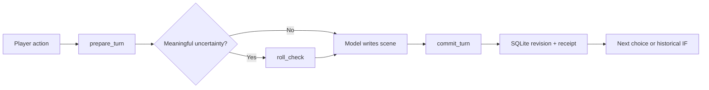

# Branchwright MCP

**Let your model tell the story. Let the engine keep the receipts.**

[](https://github.com/KinsonLai/branchwright-mcp/actions/workflows/ci.yml)
[](LICENSE)

[繁體中文](README.zh-TW.md) · [Five-minute demo](#try-it-in-five-minutes) · [Build a world](docs/world-packs.md) · [Tool reference](docs/tools.md) · [Contributing](CONTRIBUTING.md)

A **headless MCP server for persistent, branching LLM text adventures**. Bring an MCP-capable chat client and a setting. Branchwright handles the canon, dice, inventories, private knowledge, world clocks and saves. Your model handles the prose.

No web UI. No model API key in the server. No subscription. Local SQLite storage.

```text
PLAYER  “Inspect the receiver. Don't tell Ren what I find yet.”
MODEL   prepare_turn → roll_check → commit_turn
ENGINE  Persists the roll. Records the finding for the player only.
RETRY   Same request + same key → same receipt, no duplicate cost.
IF      “What if I had left it alone?” → fork revision0, main untouched.
```

This example describes the executable engine demo below, not an advertised live-model transcript.

## Why an engine behind the chat?

A long prompt cannot make an inventory transactional. A model's recap is not a save file.

Branchwright gives an adventure a small, inspectable backend:

| Capability                                 | What actually happens                                                                                                               |
| ------------------------------------------ | ----------------------------------------------------------------------------------------------------------------------------------- |
| **Fork any saved moment**                  | A new timeline copies the historical state and knowledge. The original keeps going.                                                 |
| **Characters have information boundaries** | NPC knowledge stores the value they observed. A secret update doesn't silently update their memory.                                 |
| **Rolls have consequences**                | d20 rolls are persisted; submissions must incorporate the whole check set, including failures.                                      |
| **Saves have receipts**                    | Atomic revisions and request keys make exact retries safe. Query an uncertain result before replaying it.                           |
| **Canon has citations**                    | Local FTS5/BM25 retrieval returns source hashes and line ranges, with CJK bigram support.                                           |
| **The world has a clock**                  | Seeded, weighted events use game time and cooldowns. Preview first; save when committed.                                            |
| **Settings are replaceable**               | JSON packs define attributes, tracks, characters, difficulty and events. No cultivation, class or genre hard-coded into the engine. |
| **The model gets an operating manual**     | MCP tools, a resource and a prompt expose the skill, workflows and live schemas.                                                    |

## Try it in five minutes

Requires **Node.js 24+** and npm. No build step or external database.

```sh
git clone https://github.com/KinsonLai/branchwright-mcp.git
cd branchwright-mcp
npm ci
npm run demo
```

The demo creates an in-memory space adventure, retrieves canon, rolls actual dice, commits once, retries the same request, checks an NPC's knowledge and forks a historical moment. It includes assertions and does not create a permanent save. Dice results vary.

Then connect a client using stdio:

```json
{
  "mcpServers": {
    "branchwright": {
      "command": "node",
      "args": ["/absolute/path/to/branchwright-mcp/src/cli.mjs"],
      "env": { "BRANCHWRIGHT_DB": "/absolute/path/to/my-adventure.sqlite" }
    }
  }
}
```

Use an absolute executable path if your client cannot find `node`. On Windows, use forward slashes or escaped backslashes in JSON paths. This is a common stdio configuration shape; each client controls its own configuration and approvals.

Ask your client:

> Read Branchwright's operating guide. Create a campaign using the `signal` template. Let me choose consequential actions, keep NPC knowledge separate, and confirm saves only from committed receipts.

For an existing campaign, list campaigns and branches instead of creating a new one.

## Three original starting worlds

| Pack                                 | Genre               | Opening question                                      |
| ------------------------------------ | ------------------- | ----------------------------------------------------- |
| [`lantern`](examples/lantern.json)   | Folk fantasy        | Why did the bridge-town lighthouse go dark?           |
| [`signal`](examples/signal.json)     | Space salvage       | Who is sending a message addressed to your ship?      |
| [`blackout`](examples/blackout.json) | Urban investigation | Why do the witnesses disagree during a city blackout? |

These small, original packs are included under MIT. Bring your own world through `create_campaign.world` and import authorized story text through `ingest_canon`. [Pack guide →](docs/world-packs.md)

## HTTP without a web app

```sh
npm run start:http
```

This binds `http://127.0.0.1:3333/mcp` by default. It serves MCP only; `/` is not a dashboard. Set `BRANCHWRIGHT_TOKEN` to require a bearer token, including for local requests.

For a remote server, bind `--host 0.0.0.0`, set a random token of at least24 characters and `BRANCHWRIGHT_ALLOWED_HOSTS` to your public hostname. Put TLS and request limits in front of it. HTTP is **single-owner**: every authenticated connection accesses that database. Do not share a token between unrelated users.

```sh
docker build -t branchwright .
docker run --rm -p 127.0.0.1:3333:3333 \
  -e BRANCHWRIGHT_TOKEN -v branchwright-data:/data branchwright
```

The Docker entrypoint binds all container interfaces, so a token is mandatory. Export it in the calling environment before running the command. The host port above remains loopback-only.

Transport integration tests use the **official MCP SDK client** over both stdio and HTTP. Individual chat clients and hosted connectors have their own transport/authentication requirements. This release does **not** implement OAuth or claim verified ChatGPT/Claude/Grok UI integration; clients requiring OAuth need a separate compatible hosting/auth layer. [Deployment and security →](SECURITY.md)

## The small game loop



Use `read_guide(section="tools")` for the current schema for all17 tools. Full tool details come from the registered definitions, rather than a second manually copied API catalogue. See [workflows and recovery](docs/workflows.md).

## Trust, limits and status

**v0.1 is an early, single-owner engine.** Numeric validation is not narrative understanding. The model can still pick an unfair difficulty, leak a secret in prose or write an out-of-character line. The skill helps; it cannot guarantee compliance or override platform safety checks.

- Retrieval is local **lexical** search, not neural embeddings or a guarantee of recall.
- Difficulty is pack-defined; the initial mechanical system is **d20**, not every tabletop ruleset.
- World events are seeded opportunities with cooldowns, not a complete social/economic simulation.
- SQLite files contain plaintext story and save data. Back them up and keep them out of Git.
- No branch merge, save import, multiplayer isolation, automatic LLM calls or arbitrary executable plugins in this release.
- Importing a novel doesn't grant characters the author's knowledge or make that novel redistributable.

## Develop

```sh
npm ci
npm test
npm run format:check
npm run check:release
npm run demo
npm pack
```

Tests include disk reopening, scoped proofs, historical forks, NPC knowledge snapshots, resource rollback, fixed rolls, complete adjudication recovery, canon immutability and actual MCP transports. CI targets Linux, Windows and macOS on Node 24.

## Make the next world

Good first contributions: an original world pack, a reproducible model failure, better CJK retrieval fixtures or an additional rules adapter with invariant tests. Please include sources and permissions for any contributed setting.

If this engine makes your campaign easier to keep alive, a star helps other world-builders find it. Bug reports and playable examples are more useful than a promised star count. [Contribution guide →](CONTRIBUTING.md)

Related projects worth exploring: [text-adventure-handler-mcp](https://github.com/narrowstacks/text-adventure-handler-mcp) and [dmcp](https://github.com/shawnrushefsky/dmcp). Branchwright is an independent implementation, and is not affiliated with those projects or any model provider.
