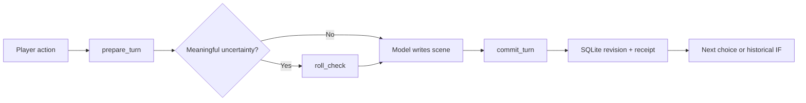

# ChatQuest AI

Play a text adventure with an AI, save your progress, and try another choice on a separate timeline.

[](https://github.com/KinsonLai/chatquest-ai/actions/workflows/ci.yml)
[](LICENSE)

[繁體中文](README.zh-TW.md) · [Try the story](#try-it-in-five-minutes) · [Connect ChatGPT, Claude or Grok](docs/clients.md) · [Playtest transcript](docs/playtest.md) · [Build a world](docs/world-packs.md)

Have a coding agent set it up: [agent installation guide](docs/agent-install.md).

ChatQuest AI keeps the inventory, rolls, story progress and each character's knowledge in local SQLite. The model reads those records through MCP before continuing a scene. That gives it something to check when a conversation gets long and details start drifting.

You can also go back to a saved decision and play a different route without overwriting the first one. JSON world packs let you write your own setting. The server provides 17 tools and has no web UI or model API calls; you bring a chat client, with its own account and hosting requirements.

The bundled demo exercises this flow with scripted prose:

```text
PLAYER  “Read the dispatch alone. Don't tell Jun what I find yet.”
MODEL   prepare_turn → roll_check → commit_turn
ENGINE  Saves the roll and records the finding for the player only.
RETRY   Same request + same key → same receipt, no duplicate cost.
IF      “Take the bridge instead.” → fork an earlier decision, main untouched.
```

## Why an engine behind the chat?

An item you've spent should stay spent. A secret you found alone shouldn't appear in an absent character's memory. ChatQuest AI stores the records for those checks. The model still has to use them correctly when writing the scene.

| Feature             | How it works                                                                                                                                      |
| ------------------- | ------------------------------------------------------------------------------------------------------------------------------------------------- |
| IF branches         | A copy of the state and knowledge at a saved revision. Both timelines stay available.                                                             |
| Character knowledge | The version of a fact that each character observed. Changing a secret doesn't update their earlier memory.                                        |
| Server dice         | Every d20 result, including failures. A submission must acknowledge the full check set.                                                           |
| Save receipts       | Atomic revisions and request keys. An exact retry returns the same receipt without charging the cost again; check recovery if a response is lost. |
| Canon search        | Local FTS5/BM25 results with source hashes and line ranges, including CJK bigram support.                                                         |
| World events        | Seeded, weighted events based on game time and cooldowns. A preview is saved only when committed.                                                 |
| World packs         | Attributes, tracks, characters, difficulties and events defined in JSON. The engine doesn't require a particular genre or class system.           |
| Operating guide     | A bundled skill, MCP resource and prompt, plus schemas for the installed tools.                                                                   |

## Try it in five minutes

If you want an agent to install and configure it, give it this prompt:

> Install ChatQuest AI for my MCP client using https://raw.githubusercontent.com/KinsonLai/chatquest-ai/main/docs/agent-install.md . Preserve my existing saves and other MCP settings, test the installation with a disposable database, and report any remaining client login or restart step.

Requires Node.js 24+ and npm. Try the story without cloning the repo:

```sh
npx --yes --package=https://github.com/KinsonLai/chatquest-ai/releases/download/v0.3.0/chatquest-ai-0.3.0.tgz chatquest --demo
```

The package downloads from GitHub Releases; it isn't published on the npm registry yet.

_The Last Ferry_ starts at a quay before a flood. The demo plays five scenes, then tries an IF branch. A failed repair uses up supplies; a failed landing causes an injury and sends you to the high bridge. The prose is prewritten, while MCP calls, dice, saves and knowledge checks run against a real server. It doesn't call a model. For a model-run session, see the [playtest transcript and findings](docs/playtest.md), including submitted scenes and receipts.

For MCP clients, omit `--demo`:

```sh
npx --yes --package=https://github.com/KinsonLai/chatquest-ai/releases/download/v0.3.0/chatquest-ai-0.3.0.tgz chatquest
```

This waits for a stdio client. Add `--http` to serve `http://127.0.0.1:3333/mcp`, or `--help` for options. Use an absolute `--db` path in client settings to resume the same save. [Connection instructions for ChatGPT, Claude and Grok →](docs/clients.md)

To work from source:

```sh
git clone https://github.com/KinsonLai/chatquest-ai.git
cd chatquest-ai
npm ci
npm run demo
```

The demo uses a separate in-memory database, so it leaves your campaign save alone. Dice results vary.

Then connect a client using stdio:

```json
{
  "mcpServers": {
    "chatquest": {
      "command": "npx",
      "args": [
        "--yes",
        "--package=https://github.com/KinsonLai/chatquest-ai/releases/download/v0.3.0/chatquest-ai-0.3.0.tgz",
        "chatquest"
      ],
      "env": { "CHATQUEST_DB": "/absolute/path/to/my-adventure.sqlite" }
    }
  }
}
```

Use an absolute executable path if your client cannot find `npx`. On Windows, use forward slashes or escaped backslashes in JSON paths. This is a local stdio configuration; ChatGPT and Grok web need the remote/tunnel setup in the [client guide](docs/clients.md).

Ask your client:

> Read ChatQuest AI's operating guide and workflows. Create a new campaign using the `ferry` template, from the beginning. Let me choose Robin's actions, keep each character's knowledge separate, and confirm saves only from committed receipts.

For an existing campaign, list campaigns and branches instead of creating a new one.

## Four original starting worlds

| Pack                                 | Genre               | Opening question                                           |
| ------------------------------------ | ------------------- | ---------------------------------------------------------- |
| [`lantern`](examples/lantern.json)   | Folk fantasy        | Why did the bridge-town lighthouse go dark?                |
| [`signal`](examples/signal.json)     | Space salvage       | Who is sending a message addressed to your ship?           |
| [`blackout`](examples/blackout.json) | Urban investigation | Why do the witnesses disagree during a city blackout?      |
| [`ferry`](examples/ferry.json)       | Harbour mystery     | Repair the ferry or take the high bridge before the flood? |

The four original packs are included under MIT. Pass your own pack through `create_campaign.world`, or add story text you have permission to use through `ingest_canon`. See the [pack guide](docs/world-packs.md).

## HTTP without a web app

```sh
npm run start:http
```

This listens at `http://127.0.0.1:3333/mcp` by default. It serves MCP requests, with no dashboard at `/`. Set `CHATQUEST_TOKEN` to require a bearer token, including for local requests.

For a remote server, bind `--host 0.0.0.0`, set a random token of at least 24 characters and set `CHATQUEST_ALLOWED_HOSTS` to your public hostname. Put TLS and request limits in front of it. Each HTTP server belongs to one owner: every authenticated connection can access that database. Don't share a token between unrelated users.

```sh
docker build -t chatquest-ai .
docker run --rm -p 127.0.0.1:3333:3333 \
  -e CHATQUEST_TOKEN -v branchwright-data:/data chatquest-ai
```

The Docker entrypoint binds all container interfaces, so a token is mandatory. Export it in the calling environment before running the command. The host port above remains loopback-only.

Tests use the official MCP SDK over stdio and HTTP. The [client guide](docs/clients.md) covers Claude's local configuration, ChatGPT's Secure MCP Tunnel route, remote HTTP and authentication requirements. OAuth is not built into this release. Account-level ChatGPT/Claude/Grok integration remains unverified. [Deployment and security →](SECURITY.md)

## The small game loop



Use `read_guide(section="tools")` for the current schemas of all 17 tools. These come from the registered tool definitions, so you can check what the installed server accepts. See [workflows and recovery](docs/workflows.md).

## Limits

v0.3 is an early release for one owner per database. A model can still pick an unfair difficulty, leak a secret in dialogue or write a character badly. The skill gives it instructions; it doesn't enforce every sentence or override platform safety checks. The [playtest report](docs/playtest.md) includes both database checks and a prose-review finding.

- Retrieval uses local lexical search. It has no neural embeddings and can miss relevant passages.
- Packs define the difficulty names and DCs. Rolls use d20; other tabletop rulesets aren't implemented.
- World events use a seeded clock, chances and cooldowns. They don't simulate a full society or economy.
- SQLite files contain plaintext story and save data. Back them up and keep them out of Git.
- No branch merge, save import, multiplayer isolation, automatic LLM calls or arbitrary executable plugins in this release.
- Keep imported canon separate from character knowledge. Importing a novel also doesn't grant permission to redistribute it.

## Upgrading from Branchwright

The project became ChatQuest AI in v0.3.0. The package is `chatquest-ai` and the command is `chatquest`; `branchwright` still works as an alias. `CHATQUEST_DB`, `CHATQUEST_TOKEN` and `CHATQUEST_ALLOWED_HOSTS` take precedence over the old `BRANCHWRIGHT_*` variables. If you haven't set the new variables, your old settings still work.

Keep your existing absolute `--db` path and Docker data volume. The default is still `.branchwright/state.sqlite` in the working directory, and saves need no migration. Campaign and branch IDs, receipts, tool names and `branchwright://` resource URIs are unchanged. We also kept the original operating-skill text and folder: pending turns use that text for validation, so renaming it would invalidate them. Refresh connector metadata to see the new server name. Old release notes and playtest receipts keep their original names.

## Develop

```sh
npm ci
npm test
npm run format:check
npm run check:release
npm run check:package
npm run demo
npm pack
```

Tests include complete success and failure story routes, CLI startup, disk reopening, scoped proofs, historical forks, NPC knowledge snapshots, resource rollback, fixed rolls, adjudication recovery, canon immutability and actual MCP transports. CI targets Linux, Windows and macOS on Node 24. See [playtest evidence](docs/playtest.md) for the model-led session and the remaining client verification gaps.

## Make the next world

You can start with an original world pack, a reproducible model failure or a CJK retrieval test case. A new rules adapter should include tests for its invariants. Include sources and permissions for any setting you contribute.

If you find it useful, a star is welcome. See [CONTRIBUTING.md](CONTRIBUTING.md) for bug reports and contributions.

Other projects in this area include [text-adventure-handler-mcp](https://github.com/narrowstacks/text-adventure-handler-mcp) and [dmcp](https://github.com/shawnrushefsky/dmcp). ChatQuest AI was implemented independently and is not affiliated with those projects or any model provider.
