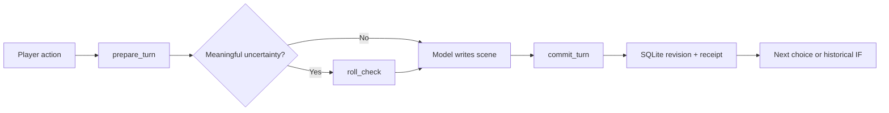

# Branchwright MCP

An MCP server for text adventures with saved state, character knowledge and alternative timelines.

[](https://github.com/KinsonLai/branchwright-mcp/actions/workflows/ci.yml)
[](LICENSE)

[繁體中文](README.zh-TW.md) · [Try the story](#try-it-in-five-minutes) · [Connect ChatGPT, Claude or Grok](docs/clients.md) · [Playtest transcript](docs/playtest.md) · [Build a world](docs/world-packs.md)

A model runs the adventure through 17 tools. Branchwright stores the canon, dice, inventory, private knowledge, world clock and saves in local SQLite. You can return to an earlier decision, play another route and keep both timelines.

The server has no web UI or model API calls. You bring a chat client; its account and hosting requirements still apply.

```text
PLAYER  “Read the dispatch alone. Don't tell Jun what I find yet.”
MODEL   prepare_turn → roll_check → commit_turn
ENGINE  Saves the roll and records the finding for the player only.
RETRY   Same request + same key → same receipt, no duplicate cost.
IF      “Take the bridge instead.” → fork an earlier decision, main untouched.
```

This example describes the executable engine demo below, not an advertised live-model transcript.

## Why an engine behind the chat?

Use it when you want the next scene to follow the saved inventory, prior rolls and what each character has learned. The engine checks numerical and storage rules; the model still has to write a coherent scene.

| Capability                                 | How it works                                                                                                                        |
| ------------------------------------------ | ----------------------------------------------------------------------------------------------------------------------------------- |
| **Fork any saved moment**                  | A new timeline copies the historical state and knowledge. The original keeps going.                                                 |
| **Characters have information boundaries** | NPC knowledge stores the value they observed. A secret update doesn't silently update their memory.                                 |
| **Rolls have consequences**                | d20 rolls are persisted; submissions must incorporate the whole check set, including failures.                                      |
| **Saves have receipts**                    | Atomic revisions and request keys make exact retries safe. Query an uncertain result before replaying it.                           |
| **Canon has citations**                    | Local FTS5/BM25 retrieval returns source hashes and line ranges, with CJK bigram support.                                           |
| **The world has a clock**                  | Seeded, weighted events use game time and cooldowns. Preview first; save when committed.                                            |
| **Settings are replaceable**               | JSON packs define attributes, tracks, characters, difficulty and events. No cultivation, class or genre hard-coded into the engine. |
| **The model gets an operating manual**     | MCP tools, a resource and a prompt expose the skill, workflows and live schemas.                                                    |

## Try it in five minutes

Requires Node.js 24+ and npm. Run the fresh story demo without cloning:

```sh
npx --yes --package=https://github.com/KinsonLai/branchwright-mcp/releases/download/v0.2.0/branchwright-mcp-0.2.0.tgz branchwright --demo
```

The package comes from this repository's release, not the npm registry. The replay starts _The Last Ferry_ at the quay, plays five scenes through real MCP calls and server dice, then tries a historical IF. Failed repairs consume supplies; a failed landing causes an injury and forces the high-bridge route. It checks saves and knowledge along the way. The script writes the prose; it does not call a model. The separate [model-led playtest](docs/playtest.md) includes the actual submitted scenes and receipts.

For MCP clients, omit `--demo`:

```sh
npx --yes --package=https://github.com/KinsonLai/branchwright-mcp/releases/download/v0.2.0/branchwright-mcp-0.2.0.tgz branchwright
```

This waits for a stdio client. Add `--http` to serve `http://127.0.0.1:3333/mcp`, or `--help` for options. Use an absolute `--db` path in client settings to resume the same save. [Connection instructions for ChatGPT, Claude and Grok →](docs/clients.md)

To work from source:

```sh
git clone https://github.com/KinsonLai/branchwright-mcp.git
cd branchwright-mcp
npm ci
npm run demo
```

The demo runs a separate in-memory server and does not modify your campaign database. Dice results vary.

Then connect a client using stdio:

```json
{
  "mcpServers": {
    "branchwright": {
      "command": "npx",
      "args": [
        "--yes",
        "--package=https://github.com/KinsonLai/branchwright-mcp/releases/download/v0.2.0/branchwright-mcp-0.2.0.tgz",
        "branchwright"
      ],
      "env": { "BRANCHWRIGHT_DB": "/absolute/path/to/my-adventure.sqlite" }
    }
  }
}
```

Use an absolute executable path if your client cannot find `npx`. On Windows, use forward slashes or escaped backslashes in JSON paths. This is a local stdio configuration; ChatGPT and Grok web need the remote/tunnel setup in the [client guide](docs/clients.md).

Ask your client:

> Read Branchwright's operating guide and workflows. Create a new campaign using the `ferry` template, from the beginning. Let me choose Robin's actions, keep each character's knowledge separate, and confirm saves only from committed receipts.

For an existing campaign, list campaigns and branches instead of creating a new one.

## Four original starting worlds

| Pack                                 | Genre               | Opening question                                           |
| ------------------------------------ | ------------------- | ---------------------------------------------------------- |
| [`lantern`](examples/lantern.json)   | Folk fantasy        | Why did the bridge-town lighthouse go dark?                |
| [`signal`](examples/signal.json)     | Space salvage       | Who is sending a message addressed to your ship?           |
| [`blackout`](examples/blackout.json) | Urban investigation | Why do the witnesses disagree during a city blackout?      |
| [`ferry`](examples/ferry.json)       | Harbour mystery     | Repair the ferry or take the high bridge before the flood? |

These small, original packs are included under MIT. Bring your own world through `create_campaign.world` and import authorized story text through `ingest_canon`. [Pack guide →](docs/world-packs.md)

## HTTP without a web app

```sh
npm run start:http
```

This binds `http://127.0.0.1:3333/mcp` by default. It serves MCP only; `/` is not a dashboard. Set `BRANCHWRIGHT_TOKEN` to require a bearer token, including for local requests.

For a remote server, bind `--host 0.0.0.0`, set a random token of at least 24 characters and `BRANCHWRIGHT_ALLOWED_HOSTS` to your public hostname. Put TLS and request limits in front of it. HTTP is **single-owner**: every authenticated connection accesses that database. Do not share a token between unrelated users.

```sh
docker build -t branchwright .
docker run --rm -p 127.0.0.1:3333:3333 \
  -e BRANCHWRIGHT_TOKEN -v branchwright-data:/data branchwright
```

The Docker entrypoint binds all container interfaces, so a token is mandatory. Export it in the calling environment before running the command. The host port above remains loopback-only.

Tests use the official MCP SDK over stdio and HTTP. The [client guide](docs/clients.md) covers Claude's local configuration, ChatGPT's Secure MCP Tunnel route, remote HTTP and authentication requirements. OAuth is not built into this release. Account-level ChatGPT/Claude/Grok integration remains unverified. [Deployment and security →](SECURITY.md)

## The small game loop



Use `read_guide(section="tools")` for the current schema for all 17 tools. Full tool details come from the registered definitions, rather than a second manually copied API catalogue. See [workflows and recovery](docs/workflows.md).

## Trust, limits and status

v0.2 is an early, single-owner engine. The model can still pick an unfair difficulty, leak a secret in prose or write an out-of-character line. The skill guides its decisions; it cannot guarantee compliance or override platform safety checks. The [playtest report](docs/playtest.md) separates database checks from prose review.

- Retrieval is local **lexical** search, not neural embeddings or a guarantee of recall.
- Difficulty is pack-defined; the initial mechanical system is **d20**, not every tabletop ruleset.
- World events are seeded opportunities with cooldowns, not a complete social/economic simulation.
- SQLite files contain plaintext story and save data. Back them up and keep them out of Git.
- No branch merge, save import, multiplayer isolation, automatic LLM calls or arbitrary executable plugins in this release.
- Importing a novel doesn't grant characters the author's knowledge or make that novel redistributable.

## Develop

```sh
npm ci
npm test
npm run format:check
npm run check:release
npm run check:package
npm run demo
npm pack
```

Tests include complete success and failure story routes, CLI startup, disk reopening, scoped proofs, historical forks, NPC knowledge snapshots, resource rollback, fixed rolls, adjudication recovery, canon immutability and actual MCP transports. CI targets Linux, Windows and macOS on Node 24. See [playtest evidence](docs/playtest.md) for the model-led session and the remaining client verification gaps.

## Make the next world

Good first contributions: an original world pack, a reproducible model failure, better CJK retrieval fixtures or an additional rules adapter with invariant tests. Please include sources and permissions for any contributed setting.

If you use Branchwright, a star helps others find it. To contribute, start with a world pack or a reproducible bug. [Contribution guide →](CONTRIBUTING.md)

Related projects worth exploring: [text-adventure-handler-mcp](https://github.com/narrowstacks/text-adventure-handler-mcp) and [dmcp](https://github.com/shawnrushefsky/dmcp). Branchwright is an independent implementation, and is not affiliated with those projects or any model provider.
